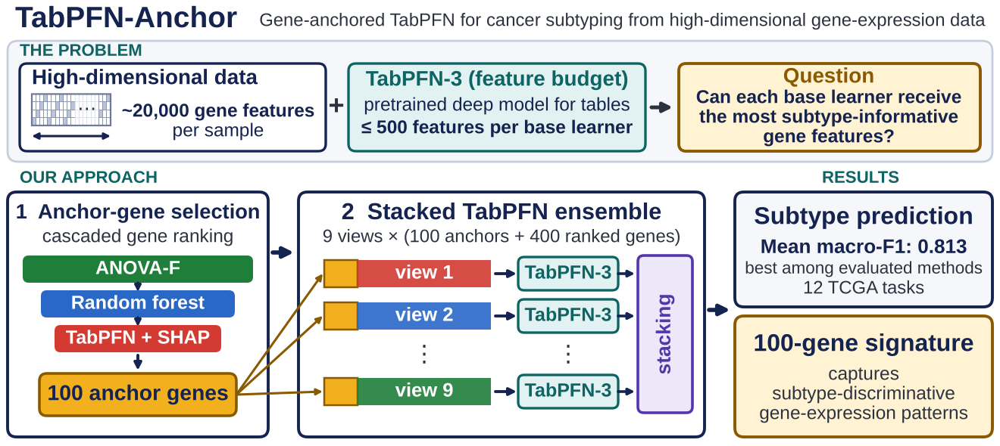

# TabPFN-Anchor

**Anchor-based TabPFN for high-dimensional tabular classification,
with an application to cancer-subtype classification from gene-expression data.**

TabPFN is a pretrained tabular foundation model that works well on small
datasets, but each of its estimators reads only a limited number of features
(500 for the TabPFN-3 checkpoint used here). TabPFN-Anchor lets a frozen TabPFN
backbone use inputs with thousands to tens of thousands of features:

1. **Anchor selection.** A cascaded feature ranking (one-way ANOVA *F* →
   Random Forest importance → TabPFN-based OddSHAP attribution) orders the
   features and keeps the top 100 as *anchors*.
2. **Stacked multi-view TabPFN ensemble.** Each of *K* = 9 views contains the
   anchors plus a different block of 400 next-ranked features. A frozen TabPFN
   model is fitted to each view, and a logistic-regression meta-learner stacks
   their out-of-fold probabilities.

The result is a scikit-learn classifier you can drop into any benchmark, plus a
compact anchor feature set you can report and evaluate on its own. The method
needs only a numeric feature matrix and class labels, so it can be applied to
any high-dimensional, low-sample-size classification problem. It was developed
and evaluated on cancer gene-expression data (12 TCGA cohorts, about 20,000
genes each), where the anchors form a 100-gene signature; its behaviour on
other kinds of data has not been evaluated.



This is the reference implementation of the following paper, **accepted for
publication in *IEEE Access* (2026)**:

> H. Ahn, "TabPFN-Anchor: Anchor-Conditioned Ensemble Adaptation of a Tabular
> Foundation Model for High-Dimensional Cancer Subtype Classification,"
> *IEEE Access*, 2026. Accepted for publication.

---

## Installation

Requires **Python 3.12 or later** (needed by `shapiq >= 1.6`). A GPU is
strongly recommended.

```bash
git clone https://github.com/aipply-ahn/tabpfn-anchor.git
cd tabpfn-anchor
pip install -e .
```

**The TabPFN backbone.** On first use the `tabpfn` package downloads the
TabPFN-3 checkpoint (about 203 MB). It asks you to log in with Prior Labs and
accept the model licence; on a headless machine, accept the licence on the web
and set `TABPFN_TOKEN`. **The TabPFN-3 weights are under a non-commercial
licence** — see [THIRD_PARTY_NOTICES.md](THIRD_PARTY_NOTICES.md).

**Name a single GPU.** Pass `device="cuda:0"` rather than leaving the default.
With several GPUs visible, the backbone's `"auto"` setting places a context on
every GPU and was about fifty times slower in our measurements.

## Quick start

### A complete example you can paste and run

The data are synthetic, straight from scikit-learn: far more features than
samples, a few informative features, many correlated with them, three classes.

```python
import pandas as pd
from sklearn.datasets import make_classification
from sklearn.metrics import f1_score
from sklearn.model_selection import train_test_split

from tabpfn_anchor import TabPFNAnchorClassifier

X, y = make_classification(
    n_samples=300, n_features=4000, n_informative=20, n_redundant=80,
    n_classes=3, random_state=0)
X = pd.DataFrame(X, columns=[f"feature_{j:05d}" for j in range(X.shape[1])])
y = pd.Series([f"Class_{chr(65 + c)}" for c in y])

X_train, X_test, y_train, y_test = train_test_split(
    X, y, test_size=0.3, stratify=y, random_state=42)

clf = TabPFNAnchorClassifier(device="cuda:0")   # defaults = published configuration
clf.fit(X_train, y_train)

pred = clf.predict(X_test)
proba = clf.predict_proba(X_test)
print(f1_score(y_test, pred, average="macro"))

clf.anchor_features_    # the 100 anchor genes, with attribution rank
clf.feature_ranking_    # every ranked gene, with the stage it was ranked in
clf.blocks_             # the gene indices given to each view
```

The same code runs as a script:

```bash
python -m tabpfn_anchor.demo.sklearn_toy
```

It takes **about nine minutes on one modern GPU**, because it uses the
published configuration; most of that time is the OddSHAP attribution step. The
run reports `views 9   distinct features used 3,700` (100 anchors plus nine
blocks of 400). The score on this synthetic task means nothing in itself.

## Execution path by number of features

With the default `mode="auto"`, the procedure that runs depends on how many
features the input has. The table below is for the default configuration
(`n_anchor=100`, `n_residual=400`, `stack_size=9`).

| Number of features | What runs | Feature ranking | Views *K* |
|---|---|---|---|
| ≤ 500 | TabPFN-3 directly | none | — |
| 501 – 2,000 | TabPFN-3 directly (each estimator samples 500 features at random) | none | — |
| 2,001 – 5,000 | TabPFN-Anchor | Random Forest → OddSHAP (ANOVA-*F* screen skipped) | 4 – 9 |
| > 5,000 | TabPFN-Anchor | ANOVA-*F* → Random Forest → OddSHAP | 9 |

In the TabPFN-Anchor rows the number of views is
*K* = min(9, ⌊(number of features − 100) / 400⌋): 4 views for 2,001–2,099
features, 5 for 2,100–2,499, 6 for 2,500–2,899, 7 for 2,900–3,299, 8 for
3,300–3,699 and 9 from 3,700 on. Each view holds the 100 shared anchors plus
400 ranked features.

**With 2,000 features or fewer, `mode="auto"` runs TabPFN-3 itself, not the
anchor ensemble, and no anchor signature is produced.** Use `mode="anchor"` to
always run the anchor ensemble, and check `clf.execution_plan_` after fitting to
see which path ran (examples 4 and 5 in [docs/examples.md](docs/examples.md)).

## Using your own data

`fit` accepts anything scikit-learn accepts. A pandas DataFrame is preferable:
the classifier remembers the column names and refuses a differently ordered
frame at prediction time.

```python
import pandas as pd
from sklearn.model_selection import train_test_split

from tabpfn_anchor import TabPFNAnchorClassifier

# Rows are samples, columns are genes, plus one column holding the label.
df = pd.read_csv("expression.tsv", sep="\t", index_col=0)
y = df["subtype"]
X = df.drop(columns=["subtype"])

X_train, X_test, y_train, y_test = train_test_split(
    X, y, test_size=0.3, stratify=y, random_state=42)

# preprocessing="rnaseq" applies log2(x + 1) to X inside fit and predict.
# Use "microarray" or "none" for data that are already on a log scale.
clf = TabPFNAnchorClassifier(device="cuda:0", preprocessing="rnaseq")
clf.fit(X_train, y_train)
pred = clf.predict(X_test)
```

`preprocessing` is applied inside `fit` and `predict`, so training and test
data always receive the same transformation:

| `preprocessing` | Transformation | Use for |
|---|---|---|
| `"none"` (default) | none | data you have already preprocessed |
| `"rnaseq"` | `log2(x + 1)` (i.e. `np.log2(1 + X)`); negative values raise an error | non-negative RNA-seq expression values not yet log-transformed |
| `"microarray"` | none | microarray data, usually already normalised and on a log scale |

Do not apply `log2(x + 1)` yourself and also pass `preprocessing="rnaseq"`;
that would transform the data twice.

| Input | Requirement |
|---|---|
| `X` | numeric, no missing values, unique column names |
| `y` | one label per row, at least two classes |
| class sizes | at least two samples in the smallest class |
| features | more than 2,000 for the anchor ensemble (see above) |

With 2,000 features or fewer, `anchor_features_` does not exist because the
anchor ensemble is not run (see
[Execution path by number of features](#execution-path-by-number-of-features)).

## Benchmarking against other methods

`TabPFNAnchorClassifier` follows the scikit-learn estimator contract (`fit`,
`predict`, `predict_proba`, `get_params`, `set_params`, `clone`), so it can be
placed in the same cross-validation loop as any other classifier. Feature
selection is fitted on the training split only, so no preprocessing outside the
estimator is needed.

To compare on the data used in the paper, with the paper's own
cross-validation splits:

```bash
tabpfn-anchor download-tcga --cohort UCEC --data-dir ./data
tabpfn-anchor tcga-example  --cohort UCEC --repeat 1 --fold 1 --data-dir ./data
```

`download-tcga` fetches the TCGA release archive from the NCI Genomic Data
Commons, verifies its size and MD5, and extracts one cohort; no data ship with
this repository (see [DATA.md](DATA.md)). `tcga-example` trains and evaluates
on one column of the cross-validation assignment distributed with that
release, so another method can be run on exactly the same partition. It writes
the anchors, the full ranking, the metrics and the resolved configuration to
`results/`.

This example shortens the attribution step so that it finishes quickly; add
`--paper-settings` to use the published settings. One split is a demonstration,
not a replication: the paper reports means over twelve cohorts and many
splits.

## Method and outputs

| Step | What it does | Keeps |
|---|---|---|
| 1.1 | one-way ANOVA *F* screen of all features | 2,000 |
| 1.2 | Random Forest feature importance (mean decrease in impurity) | 500 |
| 1.3 | OddSHAP attribution with the frozen TabPFN-3 backbone | **100 anchors** |
| 2.1 | *K* = 9 views: the anchors plus a disjoint block of 400 next-ranked features | 3,700 distinct features |
| 2.2 | one TabPFN view model per view; out-of-fold probabilities stacked by ℓ2 logistic regression | |

| Attribute after `fit` | Contents |
|---|---|
| `anchor_features_` | the 100 anchor features with their attribution rank |
| `feature_ranking_` | the full cascaded ranking and the stage that ranked each feature |
| `blocks_` | the feature indices given to each view |
| `classes_`, `n_features_in_`, `feature_names_in_` | as in scikit-learn |

Step 1.3 accounts for most of the run time. What it buys is the anchor
signature, which can be evaluated independently of the ensemble. On a
TCGA-sized cohort the published configuration takes about eighteen minutes per
outer split on one GPU.

## More examples

[docs/examples.md](docs/examples.md) has worked examples, each in a collapsible
section: preprocessing options, adjusting the cascaded ranking and the number
of anchors, changing the number of views *K*, execution modes, reading the
anchor signature, cross-validated benchmarking and shorter run times.

## Paper configuration and results

- [`configs/paper/tabpfn_anchor.yaml`](configs/paper/tabpfn_anchor.yaml) is the
  configuration that produced the reported results. Its values equal the
  estimator defaults, and a test checks that they stay equal.
  `--paper-settings` reads this file.
- [`paper_results/`](paper_results/) holds the macro-F1 of every method in every
  predictive comparison of the paper (one row per method, cohort and outer
  split) and `aggregate_stats.py`, which reproduces the reported paired
  differences, bootstrap intervals, Wilcoxon tests and Holm correction. These
  files contain results only: no expression values, sample identifiers or split
  assignments.
- [DATA.md](DATA.md) identifies the source data by GDC UUID and MD5.

This repository provides the method and its configuration. It does not include
the harness that ran the full twelve-cohort benchmark or generated the paper's
tables and figures.

## Tests

```bash
pip install -e ".[test]"
pytest -q
```

Tests that need the backbone checkpoint skip themselves when it is absent.

## Citation

If you use TabPFN-Anchor, please cite the paper (accepted for publication in
*IEEE Access*; volume, pages and DOI will be added on publication):

```bibtex
@article{ahn2026tabpfnanchor,
  author  = {Ahn, Hongryul},
  title   = {{TabPFN-Anchor}: Anchor-Conditioned Ensemble Adaptation of a
             Tabular Foundation Model for High-Dimensional Cancer Subtype
             Classification},
  journal = {IEEE Access},
  year    = {2026},
  note    = {Accepted for publication}
}
```

See also [CITATION.cff](CITATION.cff).

## License

The TabPFN-Anchor source code is released under the MIT License
([LICENSE](LICENSE)).

This repository contains no TabPFN source code and no model weights. The
default configuration uses the TabPFN-3 checkpoint, which is distributed by
Prior Labs under its own licence: non-commercial research and limited internal
evaluation are permitted, commercial and production use are restricted. The MIT
License here grants no rights to the TabPFN package, its weights, its outputs
or any third-party dataset. See [THIRD_PARTY_NOTICES.md](THIRD_PARTY_NOTICES.md)
and [DATA.md](DATA.md).
